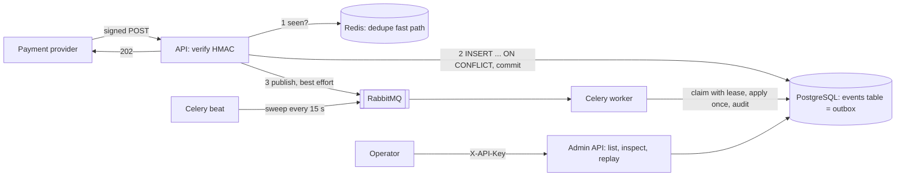

# Hookgate

**Payment providers deliver webhooks at least once, so a receiver sees duplicates, delays, reordering and retries; Hookgate receives them without losing an event and without applying any of them twice.**

A naive receiver either drops events (it crashes between answering the provider and processing) or applies an effect twice (a retry races the original). Hookgate stores every delivery durably before it answers, applies each event's effect once, and keeps resource state correct whatever the arrival order. Every claim below links to the test that proves it.

Python 3.12 · FastAPI · PostgreSQL · Redis · RabbitMQ · Celery · SQLAlchemy 2 · Prometheus · Docker Compose. Design: [`docs/srs-sdd.md`](docs/srs-sdd.md) (requirements FR-/NFR-, verification VR-).

## Quick start

Requirements: Docker with Compose.

```bash
docker compose up --build -d                       # everything, migrations included (NFR-5)
docker compose --profile demo run --rm simulator   # a simulated provider sends 73 deliveries
                                                   # (duplicates, reordering, bad signatures,
                                                   # poison) and checks the final state
```

The simulator ends with `OK (python -m simulator verify ...)` when every check passes. The API is on http://127.0.0.1:8000 (`/health`, `/metrics`, `/docs`); `docker compose down` stops it all.

## How it works



1. **Receive.** The API checks the HMAC signature and the timestamp, then inserts the event with `INSERT ... ON CONFLICT (provider, event_id) DO NOTHING` and commits **before** answering `202`. A conflict means a duplicate. Redis only remembers recent ids so duplicates skip the database; it is written after the commit, so it never knows an event that was not stored (ADR-001, ADR-003).
2. **Enqueue.** The publish to RabbitMQ is best effort. If it fails, the event is still durable, and the sweeper (run by beat) re-publishes events that were stored but never processed (ADR-002, ADR-007).
3. **Process.** A worker claims the event with a compare-and-set `UPDATE` and a lease, applies the effect and inserts into `applied_effects` (unique per event) in one transaction, and records every state change in an audit table. A crashed worker's lease expires and the sweeper hands the event to another worker.
4. **Order.** Each payment row keeps the ordering key `(occurred_at, event_id)` of its last applied event; an older event ends `processed` with outcome `ignored_stale` and no effect (FR-ORD).
5. **Fail.** Transient errors retry with capped, jittered exponential backoff; permanent errors and exhausted retries end `dead`, visible and replayable through the admin API.

## Evidence

| Guarantee | How it is proven | Where |
|---|---|---|
| No acknowledged event is lost when a worker is killed mid-task (NFR-1) | A real Celery worker process is killed with SIGKILL while it holds a claimed event; the sweeper recovers it and a second worker applies it once (VR-4) | [`tests/chaos/test_worker_kill.py`](tests/chaos/test_worker_kill.py) |
| ... when Redis goes down (NFR-1) | The real Redis container is stopped mid-sequence and restarted: every delivery 202, one row and one effect per event, readiness `degraded` then `ok` (VR-3) | [`tests/chaos/test_redis_outage.py`](tests/chaos/test_redis_outage.py) |
| ... when RabbitMQ goes down (NFR-1) | The real broker is stopped during ingestion: 202, the event waits as `received`, the sweeper enqueues it; the API and beat publish again after the restart (VR-9) | [`tests/chaos/test_broker_outage.py`](tests/chaos/test_broker_outage.py) |
| The same event delivered N times, in any order, gives one row and one effect | Hypothesis against a real database (VR-1) | [`tests/integration/test_effect_once_property.py`](tests/integration/test_effect_once_property.py) |
| 32 simultaneous deliveries of one event: one row, one enqueue, one `accepted` | 32 threads released by a barrier against a real server, with Redis up and unreachable (VR-7) | [`tests/integration/test_burst.py`](tests/integration/test_burst.py) |
| Final state does not depend on arrival order | Hypothesis over permutations of each payment's events (VR-2) | [`tests/integration/test_ordering_property.py`](tests/integration/test_ordering_property.py) |
| Retries with backoff; poison payloads end `dead` | Failing handlers with an injected clock (VR-5, VR-6); retry delay property (VR-11) | [`tests/integration/test_processing.py`](tests/integration/test_processing.py), [`tests/property/test_retry_properties.py`](tests/property/test_retry_properties.py) |
| Replay of dead events, including concurrent replays | Admin API against a real database (VR-10) | [`tests/integration/test_admin.py`](tests/integration/test_admin.py) |
| No illegal state transition | Random trigger sequences (VR-12) | [`tests/property/test_state_machine_properties.py`](tests/property/test_state_machine_properties.py) |
| Forged, altered or stale deliveries are rejected | Unit and property tests of the signature and the timestamp window (VR-8) | [`tests/property/test_signature_properties.py`](tests/property/test_signature_properties.py) |
| The whole system works end to end | `docker compose up --build`, then every simulator scenario with its oracle (CI `smoke` job) | [`simulator/`](simulator/), [`.github/workflows/ci.yml`](.github/workflows/ci.yml) |
| Quality gates (NFR-4, NFR-7) | ruff, mypy `--strict`, 100 % coverage of the domain package (gate: 80 %), no I/O imports in the domain | [`.github/workflows/ci.yml`](.github/workflows/ci.yml) |

The failure tests were each checked against a deliberate bug (sweeper not recovering leases, publish without reconnect, Redis errors not caught): each one fails with it. The chaos suite passed 10 consecutive runs before it was merged. CI runs lint, types, unit, property and integration tests, the chaos suite and the smoke test on every pull request.

## Measurements

Indicative only: one Windows 11 laptop (12 logical CPUs), the compose stack, measured from the client over HTTP on loopback with [`scripts/bench.py`](scripts/bench.py) (`make bench`). Full report: [`docs/benchmark.md`](docs/benchmark.md).

| Ingestion latency (500 sequential new events) | p50 | p95 | p99 | max | NFR-2 target (p95) |
|---|---|---|---|---|---|
| Redis up | 8.6 ms | 12.9 ms | 17.0 ms | 26.6 ms | < 100 ms: met |
| Redis down | 8.2 ms | 10.9 ms | 15.9 ms | 28.0 ms | < 150 ms: met |

| Throughput (NFR-3), 2000 new events, 8 clients | Value |
|---|---|
| Accepted by the API | 187 events/s |
| End to end, until none is pending (worker: 8 threads) | 139 events/s |

**A finding behind the Redis-down row.** The first benchmark run never finished: in the compose network a stopped Redis container makes every lookup of the name `redis` take about 3.5 s, which the 50 ms socket timeouts do not bound, so each delivery took about 7 s. The cache now skips Redis for 5 s after a failure and lets PostgreSQL decide; an outage costs one slow call per 5 s instead of two per delivery (details in the SDD, phase F12 notes). The measured Redis-down phase lasted less than one cool-down, so that occasional slow delivery does not appear in the table.

## Limitations

- Not exactly-once delivery: effectively-once effects under the stated assumptions.
- Ordering relies on the provider's `occurred_at` and on full-snapshot events; skewed provider clocks or delta events break the guarantee.
- Single PostgreSQL primary; no sharding or failover handling.
- A restored database backup can leave Redis markers for events the restored database no longer has, so redelivered events are dropped as duplicates until the markers expire; flush the Redis dedupe keys after any restore.
- While Redis is down in the compose network, one delivery every 5 s still pays the name lookup (about 3.5 s on the test machine) when the cache probes Redis again.
- One shared webhook secret, without rotation; a static admin API key.
- No rate limiting, backpressure or retention policy for stored raw bodies.
- The provider is simulated; real provider quirks are not covered.
- Throughput and latency numbers come from a single laptop and are indicative only.
- Dead events need a human to replay them; there is no alerting.

## Development

Requirements: Python 3.12, [uv](https://docs.astral.sh/uv/) and Docker with Compose.

```bash
make install                  # create the virtualenv and install dependencies
cp .env.example .env          # local development values (PowerShell: Copy-Item .env.example .env)
make up                       # start PostgreSQL, Redis and RabbitMQ and wait until healthy
make migrate                  # apply the database migrations
make run                      # start the API on http://127.0.0.1:8000
make check                    # lint + types + unit/property tests + integration tests
```

Other targets: `make format`, `make lint`, `make types`, `make test` (no database needed), `make test-integration` (needs `make up`), `make worker` (Celery worker against the local infrastructure), `make stack` (the whole system, detached), `make logs`, `make down`, `make chaos`, `make smoke` and `make bench` (see below).

Integration tests use their own databases (`hookgate_test`, created on demand); set `TEST_DATABASE_URL` to point them elsewhere. Configuration comes from environment variables only; `.env.example` lists every variable with its default.

The code follows the layers of the SDD: `domain` (pure rules, no I/O, checked in CI), `application` (use cases and ports), `infrastructure` (PostgreSQL, Redis, Celery, metrics) and `api` (FastAPI routers).

## Sending a signed webhook

`POST /webhooks/payments` accepts a delivery only if `Hookgate-Signature: t=<unix seconds>,v1=<hex>` is an HMAC-SHA256 of `<t>.<raw body>` with `WEBHOOK_SECRET`, and `t` is within 300 s of the server clock. With the API running, this sends one event using the development secret from `.env.example`:

```python
import json, time

import httpx

from hookgate.domain.signature import build_signature_header

secret = "dev-only-webhook-secret-change-me"  # WEBHOOK_SECRET in your .env
body = json.dumps(
    {
        "id": "evt_demo_1",
        "type": "payment.succeeded",
        "occurred_at": "2026-11-03T10:15:30.123456Z",
        "resource": {"type": "payment", "id": "pay_demo_1"},
        "data": {"amount": 1500, "currency": "USD"},
    }
).encode()
headers = {
    "Content-Type": "application/json",
    "Hookgate-Signature": build_signature_header(secret, int(time.time()), body),
}
response = httpx.post("http://127.0.0.1:8000/webhooks/payments", content=body, headers=headers)
print(response.status_code, response.json())  # 202 {'status': 'accepted'}; again: 'duplicate'
```

Responses: `202 accepted` or `202 duplicate`; `401` with `missing_signature`, `malformed_signature`, `invalid_signature` or `timestamp_out_of_tolerance`; `400 invalid_payload` when the body is not JSON or lacks `id`, `type`, `occurred_at` (with timezone), `resource.type` or `resource.id`; `413` above 1 MiB. Every response carries `X-Trace-Id` (the caller's value if safe, otherwise a generated one). Logs are JSON lines and never contain bodies or secrets.

## Inspecting and replaying events (admin API)

Every `/admin/*` route requires `X-API-Key` with the value of `ADMIN_API_KEY` (compared in constant time); without it the answer is `401 invalid_api_key`. With the development key from `.env.example`:

```bash
KEY="X-API-Key: dev-only-admin-key-change-me"
curl -H "$KEY" "http://127.0.0.1:8000/admin/events?status=dead&limit=20"   # oldest first
curl -H "$KEY" "http://127.0.0.1:8000/admin/events?cursor=<next_cursor>"   # next page
curl -H "$KEY" "http://127.0.0.1:8000/admin/events/<id>"                   # raw body, transitions, attempts
curl -X POST -H "$KEY" "http://127.0.0.1:8000/admin/events/<id>/replay"    # dead -> received, enqueued
curl -H "$KEY" "http://127.0.0.1:8000/admin/payments/<resource_id>"        # current payment state
```

- `GET /admin/events`: filters `status` (repeatable), `resource_id`, `event_type`; `limit` 1 to 200 (default 50). Items are ordered by `(received_at, id)`; `next_cursor` is `null` on the last page, and pages never repeat or skip an event. A cursor not produced by the API is `400 invalid_cursor`.
- `GET /admin/events/{id}`: the stored raw body (exact bytes in `raw_body_base64`, readable text in `raw_body`), headers, state, last error, transitions and attempts. `404 event_not_found` if unknown.
- `POST /admin/events/{id}/replay`: only for `dead` events; resets `attempts`, clears the retry time and the lease, keeps the history, writes an `operator_replay` audit row and enqueues the event. `202 {"status": "received", "enqueued": true}`; `enqueued` is `false` if the broker was down (the sweeper enqueues it later). Not dead: `409 event_not_dead`. Concurrent replays enqueue the event once. A poison payload replayed without a fix ends `dead` again, with the full history.
- `GET /admin/payments/{resource_id}`: the current state of one payment in the projection (status, amount, currency, `last_event_id`, `last_occurred_at`), so an external checker can confirm that the latest event won. `404 payment_not_found` if the resource never had an applied event.

## Health, metrics and tracing

- `GET /health/live`: 200 while the process can answer (restart probe; used by the compose healthcheck).
- `GET /health`: readiness, `{"status": "ok" | "degraded" | "down", "checks": {"db", "redis", "broker"}}`. Redis or the broker down is `degraded` with 200 (ingestion still works: Redis is only a fast path and the sweeper recovers unpublished events); the database down is `down` with 503.
- `GET /metrics` on the API and `http://127.0.0.1:9100/metrics` on the worker (`WORKER_METRICS_PORT`), in Prometheus text format. Each process counts what it changes: the API counts deliveries (`hookgate_events_received_total{outcome}`, `hookgate_duplicates_total{layer}`, `hookgate_cache_errors_total{op}`); the worker counts processing (`hookgate_events_processed_total{outcome}`, `hookgate_events_retried_total`, `hookgate_events_dead_total{reason}`, `hookgate_processing_seconds`). The API also serves `hookgate_events_by_status{status}`, computed with one database query per scrape.
- Every log line is JSON. The `trace_id` of a delivery (the caller's `X-Trace-Id` or a generated one) is stored on the event and sent to the worker as a message header, so `docker compose logs api worker | grep <trace_id>` shows the whole path of one event.

## Simulating a provider

`simulator/` plays the payment provider. It builds a deterministic plan from a scenario and a seed, signs every delivery when it sends it, and then checks the result with an expected-state oracle through the admin API: every valid event stored once and answered `accepted` exactly once, rejected deliveries never stored, poison events `dead` and listed, and every payment equal to its latest event. It does not import `hookgate`: it treats the service as a black box.

```bash
make simulate                                  # chaos, seed 7, against http://127.0.0.1:8000
make simulate SCENARIO=out_of_order SEED=3
uv run python -m simulator list                # happy, duplicates, delayed, out_of_order, burst,
                                               # bad_signature, expired, poison, chaos
make demo                                      # the same inside the compose network (demo profile)
```

Each run gets a random run id that prefixes its event ids, so runs never collide; the output ends with the `verify` command that re-checks that run later. Exit code 0 means every check passed. `HOOKGATE_URL`, `WEBHOOK_SECRET` and `ADMIN_API_KEY` (or `--url`, `--secret`, `--api-key`) point it at another deployment.

## Failure suite

`make chaos` (needs `make up`) runs the three chaos tests of the evidence table with real services and processes: the tests stop and start the compose services with `docker compose` and kill real worker processes. They use their own queue (`hookgate.chaos`), so a running `make stack` does not interfere, and every test waits on state with a timeout, never on fixed sleeps. Besides VR-3, VR-4 and VR-9, two regression tests cover a finding of phase F7: after a broker restart, the API's first publish and Celery beat's sweeps must go through.

`make smoke` starts the whole system (`docker compose up --build`) and runs the simulator's chaos scenario; the `smoke` CI job also runs every scenario on its own. `make bench` measures latency and throughput against the running stack (it stops and restarts Redis) and writes `docs/benchmark.md`.

## Decisions

- [ADR-001: PostgreSQL is the source of truth](docs/adr/001-postgresql-source-of-truth.md)
- [ADR-002: RabbitMQ as the broker, separate from the Redis cache](docs/adr/002-rabbitmq-broker.md)
- [ADR-005: Synchronous SQLAlchemy 2.0 with psycopg 3 everywhere](docs/adr/005-sync-sqlalchemy.md)
- [ADR-007: Lease plus sweeper instead of broker redelivery](docs/adr/007-lease-and-sweeper.md)
- [ADR-011: The pure transition() function decides; SQL applies](docs/adr/011-pure-transition-sql-applies.md)
- [ADR-012: Celery worker uses the thread pool](docs/adr/012-celery-thread-pool.md)

The other decisions are recorded in the SDD (section 7, ADR index, and section 18).

## License

MIT